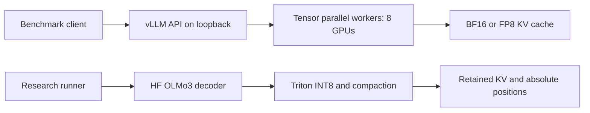

# Design and implementation

## Serving

`kv-lab serve` reads TOML, validates a Hugging Face model SHA, checks CUDA, and starts vLLM through an argument list. The API secret is inherited through `VLLM_API_KEY`. Tensor parallelism shards model operations on one VM using multiprocessing/NCCL. A single VM avoids adding Ray, multi-node rendezvous, and cross-VM InfiniBand configuration to the initial experiment.

Continuous batching is provided by vLLM. The load generator maintains bounded outstanding requests; it does not concatenate unrelated prompts into a single sequence. Chunked prefill allows work from longer inputs to be scheduled alongside decode. Prefix caching is disabled for controlled comparisons.

This implementation provides **single-node, multiple-GPU distributed inference**. Multiple Azure VMs can host independent replicas, but multi-node tensor parallelism, load balancing, HA, and autoscaling require another deployment design and are not implemented here.

## Custom cache

The research cache implements the Transformers cache update interface. Attention receives a temporary BF16/FP16 reconstruction of old K/V and the current unquantized K/V. Persistent storage holds INT8 values and FP32 scales. Stored old tokens are never requantized on append.

The OLMo3 attention function is registered through Transformers' attention registry for this process only. SDPA computes attention. A separate final-query calculation observes attention importance without materializing all prefill queries' attention probabilities. Scores accumulate as `0.9 * previous + observed_probability`, averaged across heads. Selection averages scores across full-attention layers and takes the highest-scored unprotected tokens.

After each forward, full-attention cache rows are compacted to the shared retention set. Sliding layers compact to the last `window - 1` tokens. Shared full-layer positions let one full-attention mask serve all full layers; sliding-layer positions similarly agree. Explicit absolute-position masks preserve causal and native sliding constraints for noncontiguous retained tokens. Cached keys already contain their original RoPE rotation; they are not rotated again after compaction.

The runner passes absolute `cache_position` and `position_ids`, sets `use_cache=True` explicitly (the upstream model config disables it by default), and chunks prefill. It rejects CPU/disk weight offload because that would confound GPU measurements.

## Limits

- Research generation supports OLMo3, one unpadded sequence, greedy fixed-length decoding. Beam search, cache rollback, batched requests, HF `generate`, and speculative decoding are outside this cache's supported interface.
- No custom INT8 attention GEMM is included. INT8 storage is dequantized before SDPA.
- Appending/gathering reallocates tensors and moves O(T) data; a production cache would use preallocated pages, fused attention, allocator integration, and asynchronous execution.
- Attention importance uses the last query from each prefill chunk; changing chunk size changes the policy's observations.
- Scoring performs extra work even for the research baseline so all research variants use the same decoder machinery.
- There is no vLLM private-API monkey patch. A native vLLM implementation would need allocator/block-table accounting, attention metadata, mixed sliding/full attention support, absolute positions, prefix-cache invalidation, and speculative rollback tests.

## Verification boundary

CPU tests compare a tiny real OLMo3 model's cache-free logits against the research decoder across a sliding-window boundary. They also verify absolute positions and budgets after INT8 eviction, stable quantized append, bounded request concurrency, streaming failure accounting, and exact input-token workloads. GPU tests compare Triton results against Torch references, including non-power-of-two head dimensions. The 32B model, NCCL, FP8 attention backend, and GPU timings still require the Azure GPU run.
